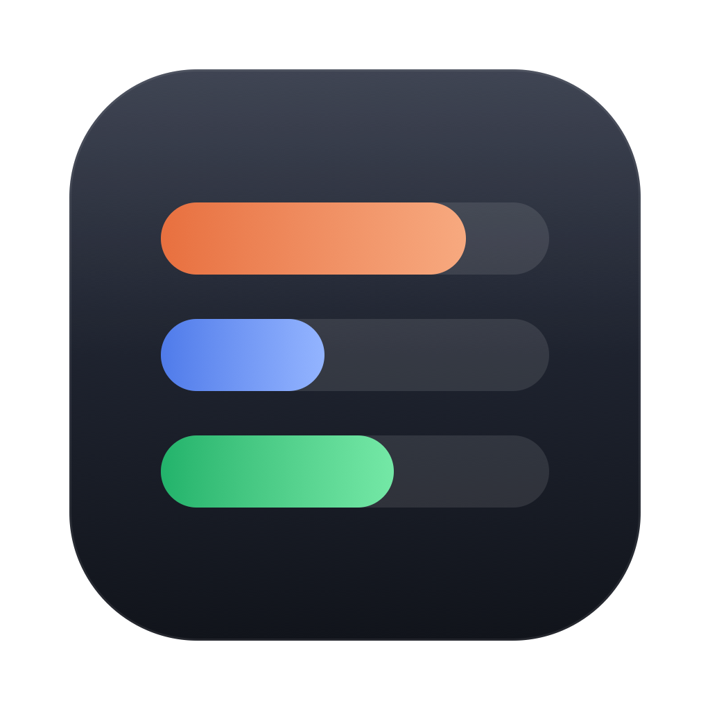

# AI Quotabar

A macOS menu bar app that shows how much of your AI coding agents' usage limits is left, when each limit resets, and which agent sessions are running. It follows the system light/dark appearance.

Supported providers: **Claude Code, Codex, Cursor, GitHub Copilot, Antigravity**, and **Grok** (listed, no usage data yet). Choose which ones appear in Settings. On first launch only Claude Code and Codex are enabled, if installed; if neither is, every installed provider is enabled.

## Install

1. Download `AIQuotabar.dmg` from the [latest release](https://github.com/7emredulek7/ai-quotabar/releases/latest), open it and drag **AI Quotabar** onto **Applications**. (A `.zip` of the app is there too.)
2. The app is not notarized, so macOS blocks the first launch. Either right-click the app and choose **Open**, or run:

   ```bash
   xattr -dr com.apple.quarantine "/Applications/AI Quotabar.app"
   ```

Requires macOS 14 or later. Turn on **Launch at login** in Settings to start it automatically.

## Build from source

```bash
./scripts/bundle.sh && open "build/AI Quotabar.app"
```

`./scripts/release.sh 0.2.1` builds a universal (Apple silicon + Intel) `build/AIQuotabar.dmg` and `build/AIQuotabar.zip` for a release.

For debugging, print what every provider returns: `swift build && .build/debug/AIQuotabar --dump`

## Where the numbers come from

| Provider | Source | Shown |
|---|---|---|
| Claude Code | `api.anthropic.com/api/oauth/usage`, with Claude Code's OAuth token from the Keychain | 5-hour, weekly |
| Codex | The latest `rate_limits` event in `~/.codex/sessions/**.jsonl` | 5-hour, weekly (as of Codex's last run) |
| Cursor | `api2.cursor.sh` DashboardService, with the session token from Cursor's local `state.vscdb` | Billing cycle (weekly or monthly) |
| GitHub Copilot | `api.github.com/copilot_internal/user`, with `gh auth token` | Monthly premium requests |
| Antigravity | The local language server (`GetUserStatus`), while the app is running | Gemini and Claude + GPT model quotas |
| Grok | — | No usage source yet |

The agent list covers Claude Code (`~/.claude/sessions/<pid>.json`) and Codex (session logs written in the last 30 minutes).

Tokens are never refreshed or stored; each is only sent to its own provider's server. Provider icons are read at runtime from the apps installed on your Mac.

None of these are documented public APIs, so a provider update can break them.
